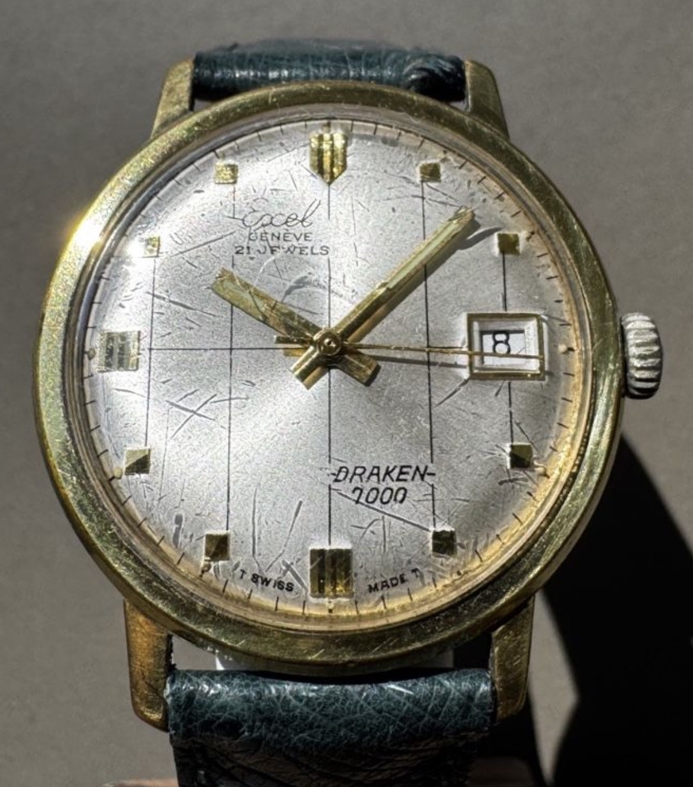
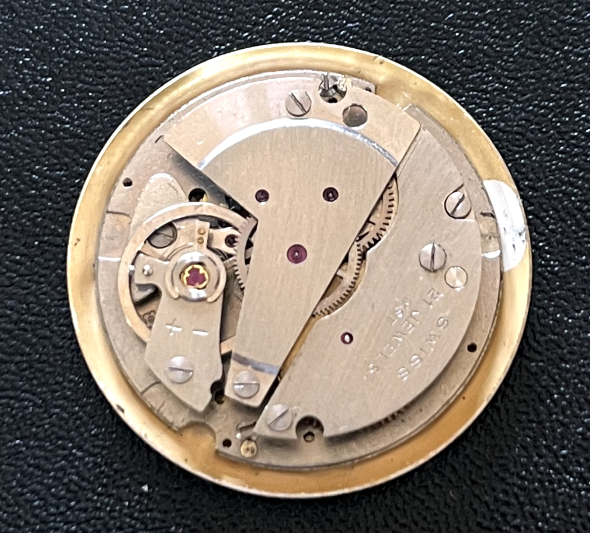
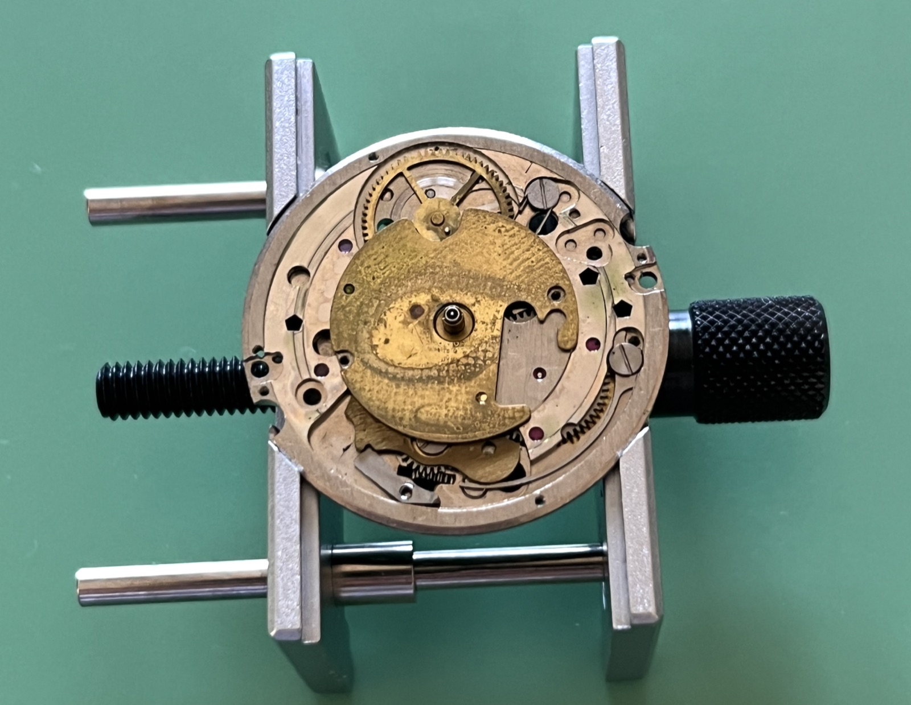
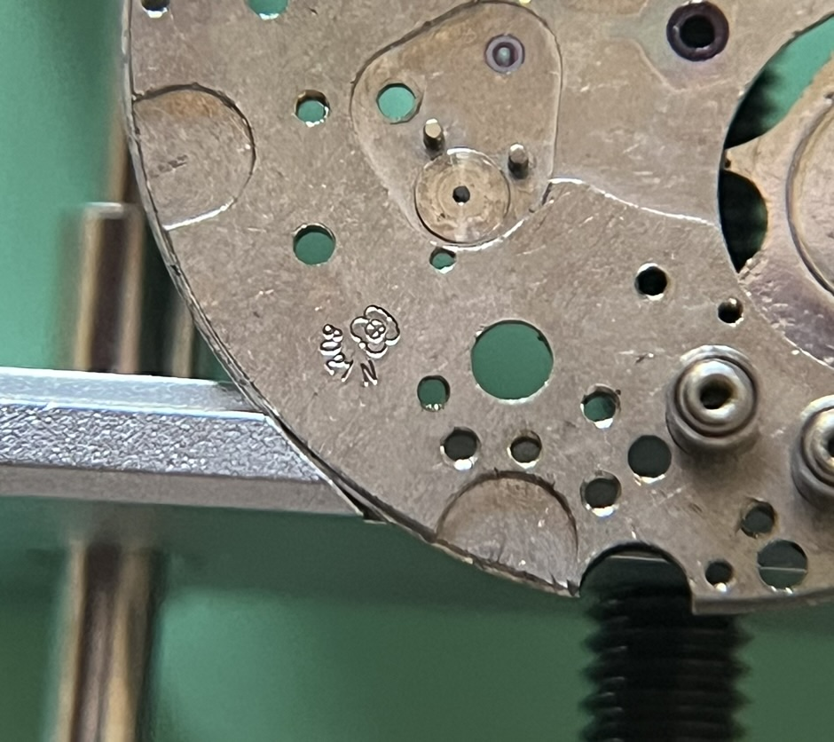
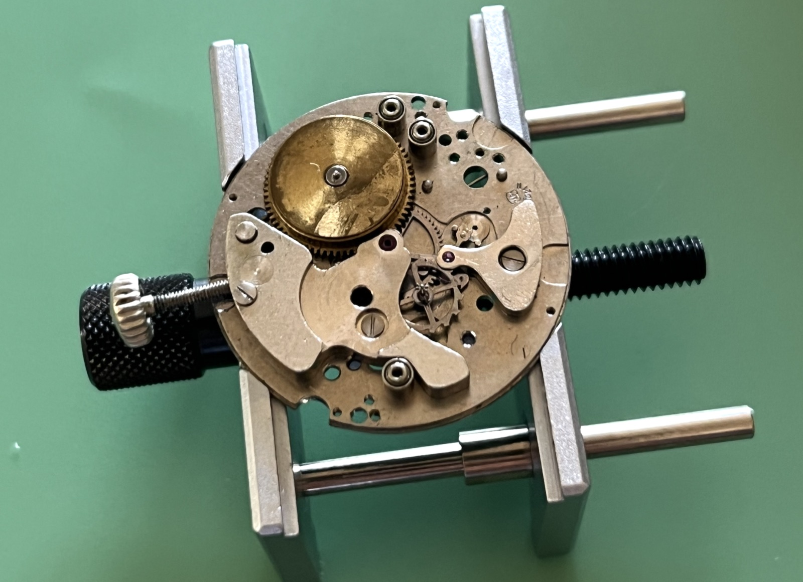

## Background
After my first attempts at movement dis- and re-assembly on a Seagull ST36 (a Chinese pocket watch movement) off of AliExpress, I decided it was time to level up. In fact I bought two "practice" movements, one was a really cheap "Excel Geneve Draken" for 21 Swiss francs, the other a Seiko Crown 560 (more on that later). The Draken (a watch I couldn't find anything on) is a handwound watch with a calendar complication and was sold as a non-runner with a pretty roughed up crystal. It came on a pretty decent ostrich leather strap, so 21 bucks seemed like an okay deal. I thought I was prepared for what was coming: basic tools, equipment to polish the crystal, naphtha and IPA to clean the parts and a simple ultrasonic cleaner. 

## Diagnosis

I opened the watch, and started disassembling. I was surprised how hard it was to get a hold of the screws, have nothing flying away or drop it into the abyss that is my dining room carpet, even after the ST36, which is already quite small, but as a pocket watch movement, it is in fact quite bulky. A first complete disassembly revealed three things:
1. The watch must have been dipped in some lubricant at some point. It was full of old grease, as was my work mat after this exercise.
2. The spring that engages the calendar wasn't in place. It somehow fell out before I could localize where it was supposed to sit. This pushed some sweaty pearls onto my forehead, but luckily it turned out to be quite obvious where the spring should sit. 
3. The main plate revealed more about the watch's identity: "Ebauches Bettlach EB 8021N", a manufacturer of "Ebauches"[^ebauche] based in Bettlach in the canton of Solothurn, Switzerland. Not exactly Geneva, is it?

According to the [Ranfft watch database](https://ranfft.org/manufacturer/77-Ebauches-Bettlach), Ebauches Bettlach "specialised in lower-end pin-lever and Roskopf movements for the volume market".

  <figure>
    
    <figcaption>Dial side, date wheel removed</figcaption>
  </figure>
  <figure>
    
    <figcaption>The EB 8021N stamp on the main plate</figcaption>
  </figure>

I think a combination of 1 and 2 was the reason the watch wasn't running. It came back to life after soaking up some of the excess Brent-grade lubricant and putting the spring where it belonged. I regret not having done a more systematic analysis here, but a runner is a runner! Boy was I proud, but not for long.

<figure>
  
  <figcaption>The movement side before cleaning, with excess oil clearly visible on the barrel</figcaption>
</figure>

## Service / Repair

Well, since not much was to be repaired after all, I prepared the cleaning solutions and put part group by part group in it - still being quite paranoid I would lose or mix up screws of the different bridges. While the parts were soaking in the solvents, I turned to the crystal. I used sandpaper sticks from Amazon (grit 800 -8000 and polywatch) to first remove all the scratches with a low grit, and then move up towards higher and higher numbers, always 90° compared to the last round until the previous round's (micro-)scratches disappeared. A final round of polywatch left a nearly perfect crystal. Quite astonishing how easy that was and how good it looks. 

After the cleaned parts were reassembled, which to my own surprise went down without any major incidents, and the watch instantly started running, I immediately noticed a massive beat error: you could hear it galloping like a horse! That needed to be investigated. And this is where things went south, but also where I probably learned the most. 

## The disaster

I should have probably left it as it is. I did not. It's a pin-lever movement meaning it has metal pins on the pallet fork, where higher end watchmakers would use jewels to reduce friction and material wear.

I should have probably read more about the construction of the balance, how to disassemble it and adjust the beat error. I also did not do that. 

I somehow managed to bend both the hairspring AND the regulator pin. While I was able to cautiously bend the pin back to its destined position, the hairspring gave me nightmares. Full of shame before myself I tried to undo what I had caused, not realizing that all I needed to do was open the regulator, put the spring back in its place. I spare you the details: I ended up breaking both the stud screw and the hairspring from the stud and, in my frustration, also broke the balance shock spring in half. Farewell Draken! 

## The recovery

Traumatized, I set this project aside and started to look for spare parts on eBay, other watches using these Ebauche movements, but nothing seemed worth it. I've stopped this sunk-cost fallacy and accepted it as a learning opportunity:

1. Read up before you touch (and break) stuff
2. Learn how to handle the balance and hairspring

This latter insight actually turned out to be an absolute power-skill: Of all things that can go wrong, bending, breaking, or twisting the hairspring is what scared me the most. Building confidence in hairspring manipulation is what made me a lot more comfortable in handling watch movements and made me realize: worst case, I have one more thing to fix. But at least I know how to do it. I watched a ton of YouTube videos and read [an excellent guide](https://www.reddit.com/r/watchrepair/comments/1osihm9/my_hairspring_cheat_sheet_courtesy_of_henry_fried/) I found on reddit on all kinds of hairspring manipulations. It turned out to be needed already in the next project I would work on... the Seiko Crown 560.

[^ebauche]: An *ébauche* is an unfinished movement (plates, bridges, gear train) sold to watch brands, who completed, regulated, cased and branded it. Many brands never made their own movements.
